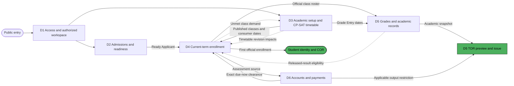
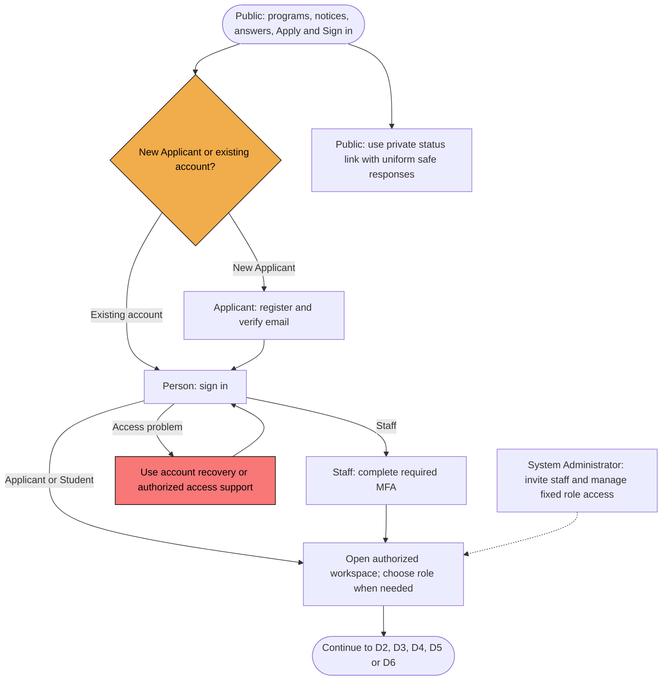
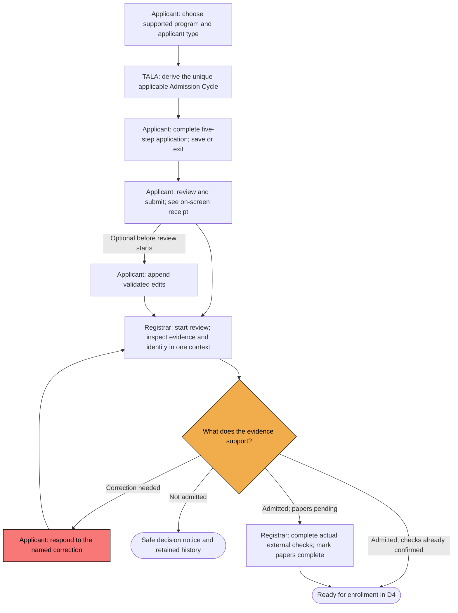
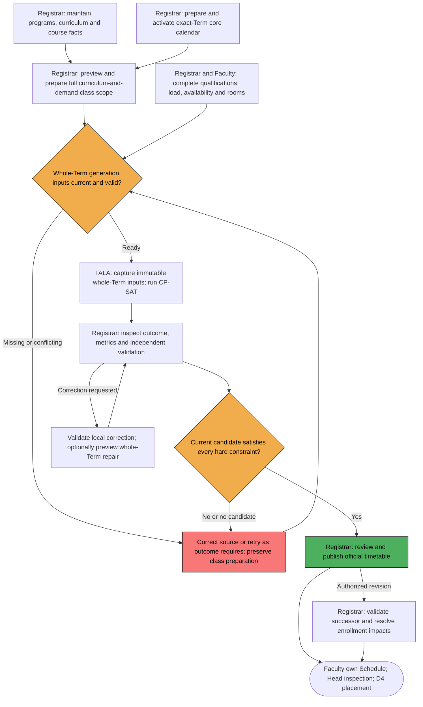
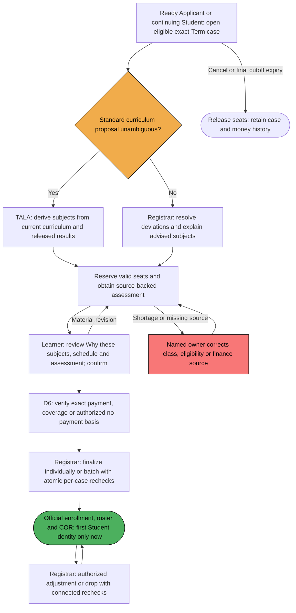
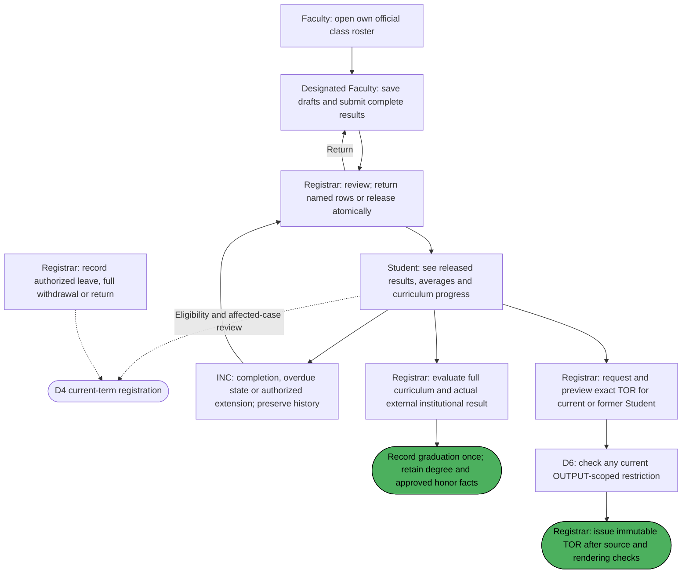
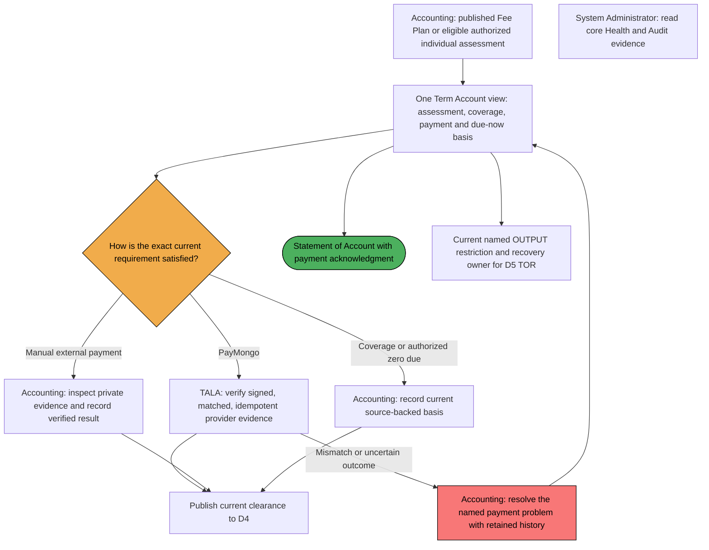

# TALA whole-system lifecycle flowchart

## How this is organized, and why

Start with D0, then open the relevant journey in D1–D6. These diagrams explain the **academic and data lifecycle**. The implementation sequence, assignments, progress and completion evidence live in [#48](https://github.com/yosoykyle/SIA-TALA/issues/48). D1–D6 are diagram labels, not delivery stages or #48 decision IDs. This reader describes the approved product; it does not establish that the code or rendered journeys conform.

The goal is one simple, connected college system: applicants understand their next step; staff work from current evidence; students can enroll, see their accounts and released results; authorized staff produce reliable official records. CP-SAT timetable generation is the principal research innovation. Independent journeys can be developed separately; their shared sources must agree when connected.

All seven roles appear here: **Applicant, Student, Registrar, Faculty, Accounting, Academic Head and System Administrator**, alongside Public visitors. Role access remains server-authorized. The Academic Head inspects authorized academic sources read-only; the System Administrator manages access, bounded public content, Health and Audit rather than academic or financial decisions.

Exact fields, validation, deadlines, permissions and transaction guards remain in the [canonical PRDs](prd_modules/README.md). The [UI Surface Blueprint](ui_surface_blueprint.md) owns observable role outcomes; [PRODUCT.md](../PRODUCT.md), [DESIGN.md](../DESIGN.md) and applicable surface briefs guide composition. The [Architecture Specification](architecture_specification.md) owns integration and deployment boundaries.

## Legend: every shape, line, and color, drawn for real

Boxes are tasks or source facts; diamonds are decisions; rounded boxes are entry or exit points. Solid arrows show the next step or a dependency; dotted arrows show a projection or feedback to another journey. Labels identify the actor and source, so color is supplementary: green for an official result, amber for a decision and light red for recovery. D0–D6 links let the reader follow a shared dependency without repeating its full rules.

Across every journey:

- Lead with the task, current status and next permitted action. Retain exact person, Term and version when opening a source or returning; provide understandable navigation, responsive keyboard access and concise error recovery.
- Reuse verified facts. Routine actions capture actor/time automatically; routine recording references are optional. Genuine exceptions and institutional curriculum, fee or policy evidence retain their actual authority requirements.
- Reject stale, unauthorized or conflicting actions without partial changes. Preserve immutable versions and attributable corrections; a display filter never narrows an official command's scope.
- Show only the named action restriction and its owner/remedy. Academic or financial restrictions do not block sign-in and do not create a general Holds & Blockers engine.
- Email failure never reverses a saved academic or money fact. Send selective action-required and official-result messages after commit; no notification center or fixed message quota is introduced.
- Keep the accepted recovery animation finite, settling within five seconds, with immediate recovery actions and a reduced-motion equivalent. Remove the visible pause/stop button on recovery. Continuing public hero motion retains its separate accessibility controls.

## D0 — Overview: the whole lifecycle on one screen

Academic planning and admissions can proceed in parallel. Enrollment consumes both; payment and academic results feed back into their owning actions.

[Access](#d1--public-entry-sign-in-accounts-and-staff-access), [Admissions](#d2--admissions-application-review-decision-and-readiness), [Academic setup](#d3--academic-setup-catalog-calendar-classes-and-timetable), [Enrollment](#d4--enrollment-proposal-seats-finalize-certificate-of-registration-and-changes), [Grades](#d5--grades-records-graduation-degree-award) and [Accounts](#d6--accounts-payment-clearance-official-outputs) give the detailed paths below.

## D1 — Public entry, sign-in, accounts and Staff access

Authority: [PRD 01](prd_modules/01_identity_access_public_entry.md).

Public content is bounded About/program information, current announcements and useful FAQ/location facts. New events/news and a general CMS are deferred. When Apply is unavailable, its reason is clear and Sign in remains available. The secure status link exposes no applicant directory or distinguishable account lookup.

One account can carry several authorized roles; the active workspace keeps that context clear. Password reset, verified email changes, session recovery and staff MFA follow PRD 01. The System Administrator cannot grant academic or financial decision authority by editing a screen or bypassing a role check.

## D2 — Admissions: application, review, decision and readiness

Authority: [PRD 02](prd_modules/02_application_admission_decision_enrollment_readiness.md).

Registrar publishes source-backed cycles and requirement sets. An Applicant chooses ordinary program/type context rather than internal cycle identifiers. Ambiguous configuration goes to Registrar setup; existing application bindings stay stable. The form covers scope, personal/contact facts, Educational Background, preliminary evidence and review. Notice acknowledgment and optional sensitive-field consent remain separate.

Draft saving and first submission recheck their public window. A submitted application can append validated successor versions until **explicit authorized review starts**; merely opening history or inspecting read-only facts does not start that lock. Afterwards only named correction scope reopens. Final decisions lock ordinary edits. A correction has its own due boundary and recovery; an overdue active correction does not automatically reject the application.

Use common correction/decision reasons plus Other, keeping the private decision basis separate from Applicant instructions. Review, evidence preview, identity resolution, decision and clearance share one working context. Combine admission and papers confirmation only when actual external checks are already satisfied; otherwise retain the single Mark papers complete follow-up. This creates readiness, not Student identity, fees or official enrollment.

Discard applies to eligible Drafts. Withdrawal before registration starts, authorized reopening/reconsideration and all prior versions retain their PRD guards. New submission uses an on-screen receipt; historically issued acknowledgments keep authorized access and complete immutable print facts. Applicant Home shows current status, the next action and contextual returns.

## D3 — Academic setup: catalog, calendar, classes and timetable

Authority: [PRD 03](prd_modules/03_academic_setup_offerings_published_timetable.md); Faculty projections also follow [PRD 05](prd_modules/05_teaching_grades_academic_records_completion.md).

The core calendar fixes the grid at 30 minutes and records approved teaching dates, weekly hours, breaks and no-class dates. Core activation does not wait for unrelated operational windows or the Faculty reply deadline. Enrollment and Grade Entry dates govern their own consumers. Missing optional Late Enrollment, Adjustment or Drop dates keep only those actions closed unless the exact authorized late path applies. Faculty reply due belongs to generation readiness. Examination Period is informational on Student Home and Faculty Schedule, with Registrar source editing and authorized Head inspection; arranging exams remains external.

Prepare classes from the full curriculum and current demand, with a reviewable bulk preview. Shared classes count once globally. Curriculum-year coverage findings are advisory; do not require every year in every Term or invent a cohort year/count. Class preparation remains available while Faculty qualifications, teaching load, availability and rooms are completed. Existing curriculum import remains available under its source guards.

Generate against **all recorded classes in the exact Term** and a coherent captured source version. Display filters never narrow generation. Distinguish Optimal, Feasible, Infeasible, Unknown, ModelInvalid and TechnicalFailure: an unknown result or technical failure does not prove infeasibility. Show truthful metric units and named source remedies. Independent hard-constraint validation governs publication, local corrections and whole-Term repair; never waive a hard constraint or silently accept a partial repair.

Candidate and official timetable share one destination but clearly retain their different state/version. Print this view and complete-schedule output preserve scope. Faculty sees only own official assignments, availability response/corrections and attributable history; Head reads authorized sources. Revisions preserve prior official snapshots and coordinate affected enrollment placements before changing their current projections.

## D4 — Enrollment: proposal, seats, finalize, Certificate of Registration and changes

Authority: [PRD 04](prd_modules/04_current_term_registration_official_enrollment.md), using [PRD 06](prd_modules/06_accounts_official_outputs_operations_assurance.md) finance and released [PRD 05](prd_modules/05_teaching_grades_academic_records_completion.md) results.

Opening one eligible Registration Case derives the unambiguous standard proposal, temporary reservations and assessment **before learner confirmation or payment**. It does not create cases for everyone merely because Enrollment opens. Ambiguous or exceptional selection goes to Registrar advice, promptly explaining the actual reason; this is not unrestricted course shopping or a permanent Regular label.

Current admission/identity facts, curriculum, released prerequisites/credits, published classes, schedule, capacity and load remain real checks. Reuse verified identity/contact facts rather than asking for another confirmation. A stale or missing source names its owner and recovery. Consumer windows and genuine late authority govern the relevant action. Registrar sees Students & Enrollment; Accounting sees focused Student Accounts from the same underlying records.

Finalization rechecks current sources, exact learner confirmation, reservations and due-now finance evidence atomically for each case. Only the first successful official enrollment creates the minimal Student profile, permanent student number and Student access on the existing account. It creates the official roster and immutable COR version; retries and failed mail cannot duplicate or reverse them.

Expiry or cancellation releases seats once, closes checkout and preserves money history in the same Term Account. Authorized reopening restores no stale proposal, confirmation, reservation, assessment or clearance automatically. Retained funds require Accounting reconciliation, not automatic refunds or lost history.

Adjustments and drops retain their window or exact late authority, placement/load/capacity checks and material learner confirmation. An add/replacement needs cleared additional cost or an authoritative no-additional-amount result. Removals route applicable finance review; TALA does not invent a refund. Released grade or timetable changes invalidate affected preparation before finalization and trigger Registrar impact review after enrollment. Existing official facts remain until an authorized change is applied. COR history stays immutable; live finance remains in the account view.

## D5 — Grades, records, graduation, degree award

Authority: [PRD 05](prd_modules/05_teaching_grades_academic_records_completion.md).

Only designated Faculty author results for official roster members. Registrar returns specified rows, releases complete results and records genuine authorized corrections. Released results, not Drafts or fabricated zeros, govern Student Academics, the Unofficial Student Record, averages and curriculum evaluation. Preserve PRD 05's numeric inclusion rules, completeness explanations, attempt history, exact approved credits and satisfying retakes.

INC completion follows its current deadline and authorized release path. An overdue INC keeps its historical mark and no-credit consequence; time does not invent a grade or send an overdue email. A valid future extension can reopen completion. A satisfying released retake or exact approved credit can satisfy the curriculum requirement without overwriting the old INC. Pending and excluded nonnumeric attempts affect average readiness according to PRD 05, rather than making every historic INC a universal blocker.

Leave, full withdrawal, return and other genuine academic restrictions block their named actions. Lifecycle changes preserve source authority and connected enrollment/account effects. Further program-shift/transfer UI refinement is deferred; existing history and guards remain.

Use one Record graduation action after full curriculum evaluation and the actual externally approved institutional result. Recording reference/date fields are optional; actual degree, effective date and approved honor facts must be real. Do not fabricate conferral or recreate an internal graduation-approval system. Keep the labelled synthetic external-competency authority-guard demonstration; it is not evidence that the institution adopted the hypothetical requirement.

A TOR can be issued for an authorized current or former Student **without a graduation record**. Request → preview → issue checks verified identity, releasable academic snapshot, request clock/reference, applicable current OUTPUT restriction, template/signatories and successful rendering. Accounting supplies the restriction source rather than approving each TOR request. Failure creates no partial artifact. Physical signature, seal, claiming/delivery and CAV remain external. Further replacement, conferral-correction, external-result and INC-amendment UI refinement is deferred; retained history, safety guards and core INC extension remain available.

## D6 — Accounts, payment, clearance, official outputs

Authority: [PRD 06](prd_modules/06_accounts_official_outputs_operations_assurance.md); operations also follow [Architecture](architecture_specification.md) and the [Runbook](TALA-Deployment-Recovery-Runbook.md).

Use one understandable assessment presentation, preserving distinct Fee Plan, individual assessment, coverage and payment source records. Missing fee authority is unavailable, not an invented FeeRule rate or zero amount. Show the exact amount required now and its basis; total account balance is not a universal zero-balance gate.

PayMongo verifies signed events against the current obligation, currency, amount, provider/reference and idempotency contract. A browser return is not proof of payment. Unavailable integration routes to the authorized alternative and understandable recovery. Manual evidence is private and externally verified; TALA is not a cashiering engine. Resolve payment problems in one Accounting context while preserving guards for mismatches, duplicate/late events, refund and chargeback facts. Money events and reversals are attributable and append-only; executing refunds remains external.

Payment acknowledgment belongs in the Statement of Account and is not a tax receipt. Historically issued separate acknowledgments retain authorized access, snapshots and print guards. A current OUTPUT-scoped restriction affects only its named official output; there is no per-request approval queue or blanket service hold. Unknown/stale source evidence closes the affected action with an owner and remedy.

Health covers mail, PayMongo and the solver with attributable read-only evidence; unknown is not healthy. Further Health beyond those three is deferred, without removing production backup/recovery duties from the Runbook. Audit remains authorized, read-only and privacy-scoped; record retention/disposal decisions remain external. Further refinement of the three CSV exports is deferred; existing exports, authorized operational prints and their data/access safety remain. No general Report Hub, provider-control console or in-app notification feed is introduced.

## Authority and notation

Use this reader to find the ordinary path, exception owner and connected source. Open the owning PRD for exact guards rather than copying a box into implementation as a complete contract. Sources are the [system baseline](prd_modules/00_system_definition_baseline.md), PRDs linked above, the Blueprint, Architecture and current composition guidance. Delivery order and concern dispositions remain in #48; [the Orchestrator Protocol](TALA-Orchestrator-Protocol.md) owns execution, verification and publication.

Reviewing these diagrams is not rendered usability acceptance, runtime verification or institutional policy evidence. Preserve earlier issued facts and attributable history while applying the current product contract.
